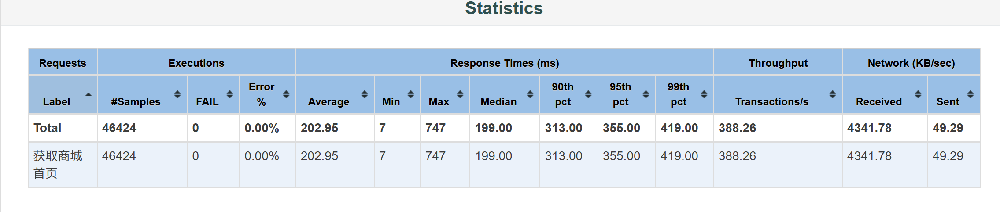
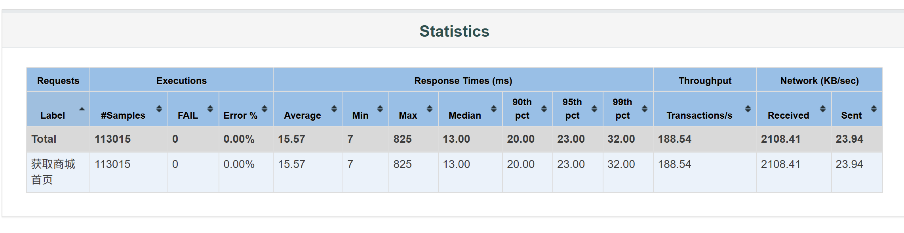

# Litemall 电商系统测试实践

本项目基于开源电商系统 Litemall 开展完整测试实践，覆盖 Docker 环境部署、管理后台与 H5/小程序端核心业务测试、接口自动化测试、数据库校验、Allure 报告以及 JMeter 性能测试。

项目重点不是单纯堆积测试用例，而是通过“接口响应、业务状态、数据库记录、服务端资源”四个层面验证系统行为，并保留可复现的脚本、报告说明和结果截图。

被测系统来源：[linlinjava/litemall](https://github.com/linlinjava/litemall)。本仓库中的测试方案、自动化代码、性能脚本、测试数据分析和项目文档为个人测试实践成果。

## 项目成果概览

| 测试方向 | 已完成内容 |
| --- | --- |
| 环境部署与排错 | 使用 Docker Compose 部署 Litemall 与 MySQL，排查端口冲突、容器时区、数据库连接和服务日志问题 |
| 功能测试 | 验证管理后台、H5 和微信小程序端的登录、商品搜索、购物车、地址、订单及多端数据同步 |
| 接口自动化 | 使用 Python、Requests、Pytest 编写 11 条核心接口回归用例，覆盖认证、商品、购物车和订单链路 |
| 数据库校验 | 使用 PyMySQL 验证订单主表、订单商品表、SKU 库存、状态变化和逻辑删除 |
| 测试报告 | 使用 Allure 展示业务步骤、动态参数、环境信息及失败诊断附件 |
| 性能测试 | 使用 JMeter 完成基准、负载、压力和稳定性测试，并结合 Docker 资源监控进行分析 |
| 性能实验 | 对 Druid 连接池和 Tomcat 工作线程开展控制变量 A/B 实验，验证调优假设 |
| 工程化 | 编写 PowerShell 脚本，实现测试执行、Docker 监控、结果汇总和 HTML 报告生成 |

## 自动化测试结果

当前核心回归集包含 11 条用例，覆盖：

- 正确登录、错误密码、空用户名和不存在用户；
- 商品存在与不存在搜索；
- 购物车正常鉴权、无 Token 和非法 Token；
- 订单结算、提交、详情查询、数据库落库、库存扣减与恢复、取消及逻辑删除。


详细设计、运行方法和订单链路说明见 [接口自动化测试说明](test-automation/README.md)。

## 性能测试结果

商城首页接口在当前本地测试环境中的逐级压力测试结果如下：

| 并发用户数 | 吞吐量（次/秒） | 平均响应时间（ms） | P95（ms） | P99（ms） | 错误率 |
| ---: | ---: | ---: | ---: | ---: | ---: |
| 20 | 35.70 | 11.18 | 16 | 19 | 0.00% |
| 50 | 88.60 | 11.99 | 18 | 23 | 0.00% |
| 100 | 176.40 | 14.59 | 27 | 50 | 0.00% |
| 200 | 347.00 | 23.17 | 46 | 109 | 0.00% |
| 300 | 388.26 | 202.95 | 355 | 419 | 0.00% |

从 200 增加到 300 并发用户时，吞吐量仅增加约 11.9%，平均响应时间约上升至原来的 8.8 倍。因此，在当前机器、接口和负载模型下，可以判断性能拐点位于 200 至 300 并发用户之间。



100 用户持续运行 10 分钟，共完成 113,015 次请求，错误率为 0.00%，吞吐量为 188.54 次/秒；测试时间窗口内未观察到明显的持续响应恶化或内存泄漏迹象。



详细的测试模型、参数说明、A/B 实验、资源分析和限制说明见 [性能测试说明](test-performance/README.md)。

## 性能调用链理解

```text
JMeter
  → Tomcat 工作线程
  → WxHomeController
  → 首页内部任务线程池
  → Service
  → Mapper / MyBatis
  → Druid 数据库连接池
  → MySQL
  → 返回 HTTP 响应
```

本项目验证了单独把 Druid 最大活跃连接数从 50 增加到 100，以及把 Tomcat 最大工作线程数从 200 增加到 400，均未改善 300 并发场景的性能。该结果说明这两项配置不是简单“调大就更快”，但现有证据不足以断言唯一性能根因。

## 项目结构

```text
litemall
├─ test-automation
│  ├─ tests                  # Pytest 接口自动化用例与 fixture
│  ├─ docs/images            # Pytest 和 Allure 结果截图
│  ├─ requirements.txt       # Python 依赖
│  ├─ run_tests.ps1          # 自动执行并生成 Allure 报告
│  └─ README.md              # 接口自动化详细说明
├─ test-performance
│  ├─ jmeter                 # JMeter 测试计划
│  ├─ scripts                # 执行、监控和分析脚本
│  ├─ docs/screenshots       # 性能测试证据截图
│  ├─ README.md              # 性能测试详细报告
│  └─ Litemall性能测试面试问答与实操.docx
├─ docker                    # Docker Compose 与服务配置
└─ pytest.ini                # Pytest 项目配置
```

生成的 Allure 报告、JMeter JTL/HTML 报告、Docker 原始监控文件和数据库运行数据不提交到 GitHub，避免仓库包含大量可重复生成的临时文件。项目保留测试代码、执行脚本、说明文档和关键结果截图。

## 快速运行接口自动化

运行前需要启动 Docker Desktop、Litemall 后端和 MySQL。

首次使用时，先在项目根目录创建本机私有配置：

```powershell
Copy-Item .\test-automation\test_config.example.json `
  .\test-automation\test_config.local.json
```

然后打开 `test_config.local.json`，填写自己环境中的接口地址、测试账号和数据库连接信息。该文件已被 Git 忽略，不会上传到 GitHub。

在项目根目录执行：

```powershell
python -m pip install -r .\test-automation\requirements.txt
powershell.exe -ExecutionPolicy Bypass -File .\test-automation\run_tests.ps1
```

## 快速运行性能测试

JMeter 安装完成且服务可访问后，在项目根目录执行：

```powershell
powershell.exe -ExecutionPolicy Bypass `
  -File .\test-performance\scripts\run_performance_test.ps1 `
  -RunName "home-smoke-1u" `
  -Users 1 `
  -RampUp 1 `
  -Duration 10 `
  -Delay 500
```

参数含义、正式压测命令及输出文件关系请查看性能测试目录中的 README。

## Docker 私有配置

首次使用 Docker Compose 前执行：

```powershell
Copy-Item .\docker\.env.example .\docker\.env
```

在 `docker/.env` 中填写本机数据库密码等配置。`docker/.env.example` 只提供字段模板，真实 `docker/.env` 不会进入 Git 仓库。

## 测试边界

- 性能结果来自本地 Windows、Docker Desktop 环境，不能直接等同于生产容量；
- 当前性能测试主要覆盖商城首页接口，不代表全业务链路性能；
- 当前自动化用例是核心回归集，并非 Litemall 全量测试覆盖；
- 配置实验主要执行一次，正式容量评估还需要同配置多轮重复并比较中位数；
- 当前没有完整 JVM、慢 SQL、锁等待和分布式监控数据，因此不宣称已定位唯一性能瓶颈。
