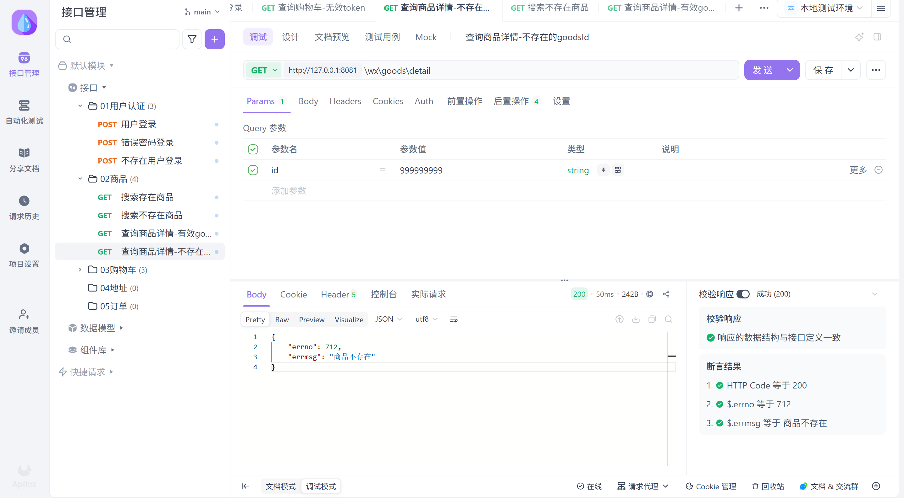
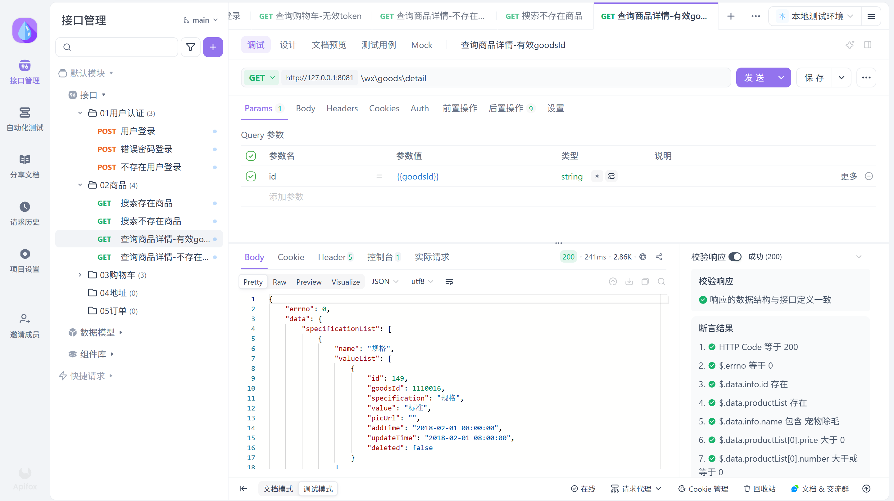
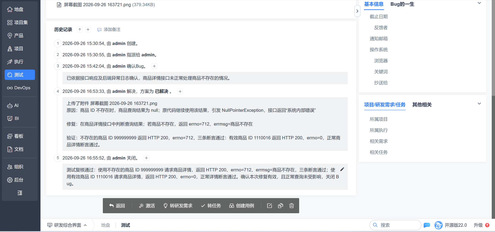

# Bug #2：不存在的商品 ID 导致商品详情接口返回系统内部错误

## 测试背景

被测系统为 Litemall，本次测试的是微信端商品详情接口：

`GET /wx/goods/detail?id=999999999`

`999999999` 是测试环境中不存在的商品 ID。测试目标是检查接口能否正确处理“不存在的商品”这一异常输入，而不只是验证正常商品能否查询。

## 发现与复现

1. 启动本地 Litemall 后端和 MySQL。
2. 使用 Apifox 请求商品详情接口，传入不存在的商品 ID `999999999`。
3. 查看 HTTP 状态码和响应体。

修复前，接口返回 HTTP 200，但响应体为：

```json
{"errno":502,"errmsg":"系统内部错误"}
```

HTTP 200 只说明收到了 HTTP 响应，不能据此判断业务处理成功。这里的 `errno=502` 和“系统内部错误”表明业务处理出现异常；对于可预见的“不存在商品”情况，提示也不够明确。

[查看禅道中的原始 Bug 记录](01-bug-record.png)

## 排查与定位

先用接口响应确认异常，再进入运行 Litemall 的 Linux 容器，查看与请求时间对应的 `/logs/error.log`。日志中的关键信息是：

```text
java.lang.NullPointerException
at org.linlinjava.litemall.wx.web.WxGoodsController.detail(WxGoodsController.java:199)
```

`NullPointerException` 表示代码使用了一个值为 `null` 的对象。结合商品详情代码检查发现：查询不存在的商品 ID 时，`goodsService.findById(id)` 返回 `null`，原代码没有先判断，后续继续使用查询结果，因此触发空指针异常。

定位依据是“同一请求的响应 → 同一时间的错误日志 → 异常类和代码位置 → 源码中的空值使用”，不是只看到“系统内部错误”就直接猜测原因。

## 修复方式

在取得商品信息后增加空值判断；商品不存在时，提前返回明确的业务错误：

```java
LitemallGoods info = goodsService.findById(id);
if (info == null) {
    return ResponseUtil.fail(WxResponseCode.GOODS_UNKNOWN, "商品不存在");
}
```

本案例仓库只记录关键修复差异和测试证据，不包含整套 Litemall 原项目源码。

## 修复后验证

| 场景 | 输入的商品 ID | 预期与实测结果 |
| --- | ---: | --- |
| 不存在的商品 | `999999999` | HTTP 200，`errno=712`，`errmsg=商品不存在`；Apifox 三条断言通过 |
| 正常商品回归 | `1110016` | HTTP 200，`errno=0`，返回正常商品详情；相关断言通过 |

这里的 HTTP 200、业务错误码 712，是当前 Litemall 接口的实际返回方式；不能把它当成所有项目都必须遵守的通用规则。





只测不存在的 ID，无法知道修改是否破坏了正常查询。因此又使用有效 ID 做回归测试：异常输入得到明确提示，正常输入仍能返回商品详情，两条路径都通过。

## 禅道缺陷闭环

在禅道中将该问题记录为 Bug #2，填写复现步骤、实际结果、预期结果，并附上接口响应和 Linux 错误日志证据。定位并修改代码后，将 Bug 标记为“已解决”；复核异常与正常两种场景通过后，记录复测结论并“关闭”。

本次为个人练习，开发修复和测试复核均使用同一个 `admin` 账号模拟。实际团队中，开发通常负责修复并填写解决记录，测试人员独立复测后决定关闭或重新激活 Bug。



## 结论与范围

本次验证证明：在当前本地测试环境下，商品详情接口能正确处理所测的“不存在商品 ID”，且所测的正常商品查询未受影响。它不代表所有非法 ID 类型、所有商品数据或其他接口都已完成测试。