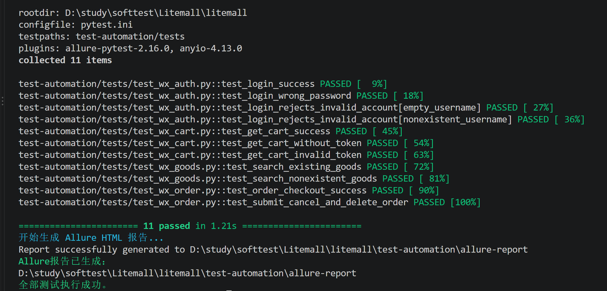
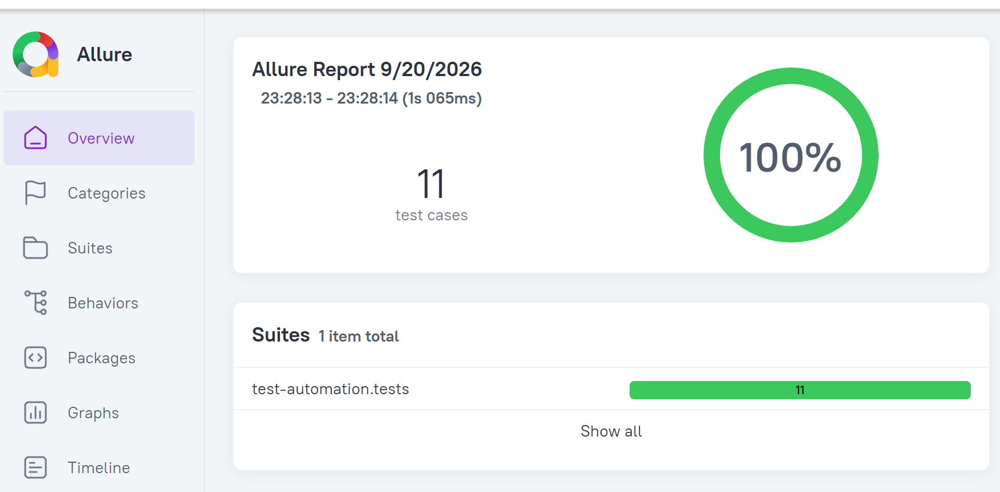
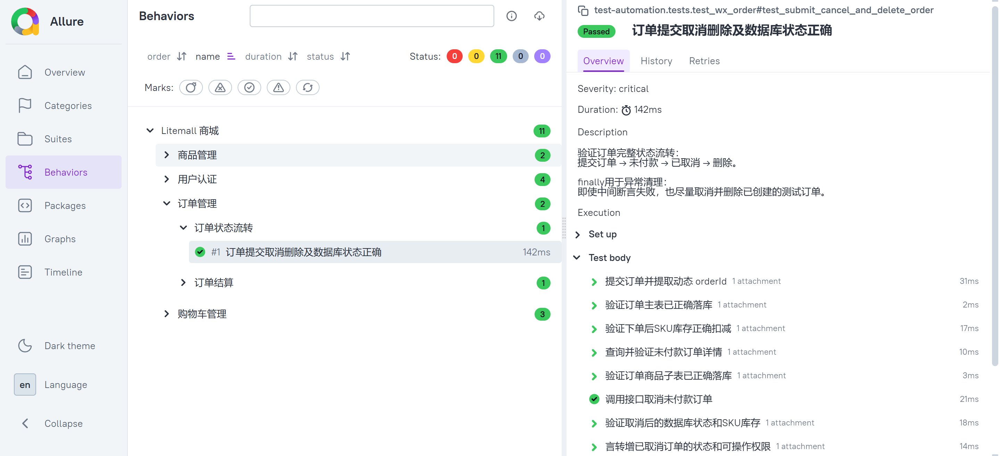
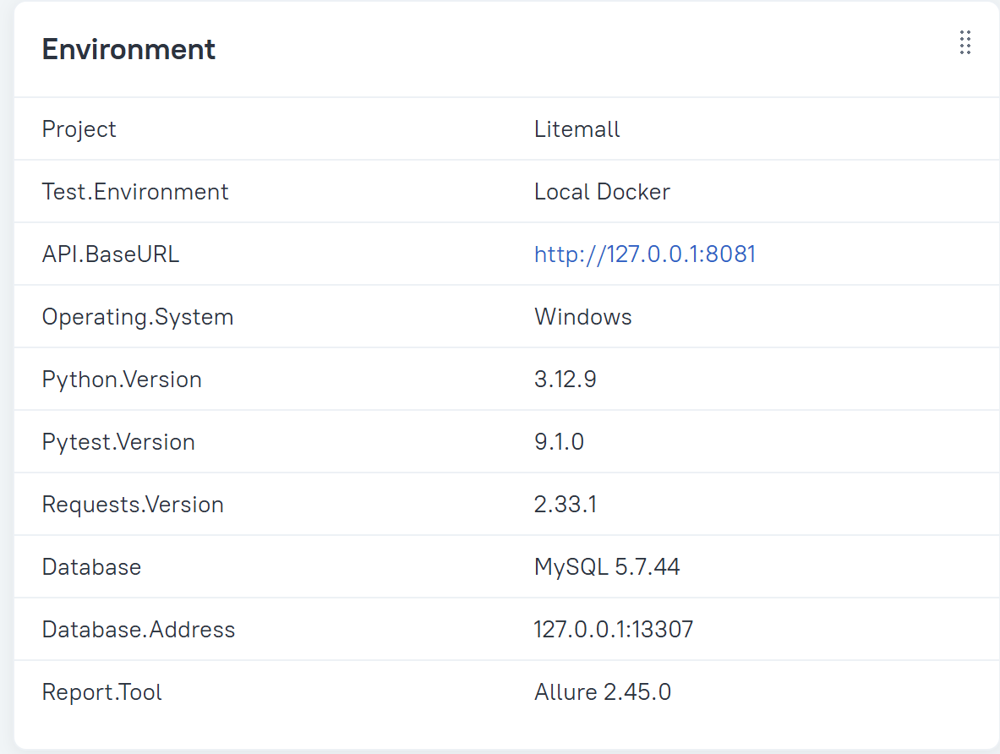

# Litemall 接口自动化测试

[](https://github.com/indolly/Litemall-testing/actions/workflows/api-tests.yml)

## 项目介绍

本项目基于 Litemall 商城系统开展接口自动化测试，覆盖用户登录、商品搜索、购物车鉴权及订单状态流转，并结合 MySQL 验证接口响应、业务状态与数据库记录的一致性。

当前自动化测试共收集 30 条用例：27 条通过，3 条因已确认缺陷标记为 `xfail`。测试结果可通过 Allure 报告展示。

## 测试成果

### Pytest 全量回归

原有 11 条核心回归用例全部通过；补充地址、参数边界、重复提交和跨用户权限后，当前结果为 `27 passed, 3 xfailed`。



### Allure 报告总览

当前核心回归集共 11 条测试，执行结果为 100% 通过。



### 订单状态流转

订单自动化覆盖提交、落库、库存扣减、详情、取消、库存恢复、权限变化及逻辑删除等步骤。



### 测试环境

报告自动记录接口地址、操作系统、Python、Pytest、Requests、MySQL和Allure版本。



## 技术栈

- Python 3.12
- Pytest 9.1.0
- Requests 2.33.1
- PyMySQL 1.2.0
- MySQL 5.7
- Docker Desktop
- Allure 2.45.0
- Java 21

## 已覆盖模块

| 模块 | 主要场景 |
| --- | --- |
| 用户认证 | 登录成功、错误密码、空用户名、不存在用户 |
| 商品 | 搜索存在商品、搜索不存在商品 |
| 收货地址 | 新增、查询、修改、删除、非法字段、未登录、跨用户访问 |
| 购物车 | 登录查询、无 Token、非法 Token、数量边界、库存边界、跨用户隔离 |
| 订单 | 结算金额、提交、详情、取消、删除、缺参、重复提交、跨用户访问 |
| 数据库 | 订单主表、订单商品子表、商品快照、逻辑删除 |
| 库存 | 下单扣减库存、取消恢复库存 |

## 自动化设计

- 使用 `requests.Session` 统一保存并复用登录 Token。
- 使用 Pytest fixture 准备登录会话、购物车、SKU、地址和数据库连接。
- 动态提取 `cartId`、`productId`、`addressId` 和 `orderId`。
- 使用 `try finally` 和 fixture teardown 清理测试数据。
- 使用 `Decimal` 验证订单金额计算。
- 使用 PyMySQL 和参数化 SQL 验证数据库记录。
- 使用 Allure 展示业务步骤、关键附件和运行环境。
- 使用 Pytest 钩子自动收集失败用例信息。

## 项目结构

```text
test-automation
├── tests
│   ├── conftest.py
│   ├── test_wx_auth.py
│   ├── test_wx_goods.py
│   ├── test_wx_cart.py
│   ├── test_wx_address.py
│   ├── test_wx_order.py
│   └── test_wx_order_security.py
├── requirements.txt
├── run_tests.ps1
└── README.md
```

## 运行前提

运行自动化测试前，需要确认：

1. Docker Desktop 已启动。
2. Litemall 后端可以通过 `http://127.0.0.1:8081` 访问。
3. MySQL 容器已启动，Windows 映射端口为 `13307`。
4. 测试账号可以正常登录。
5. 测试账号至少存在一条收货地址。
6. 测试商品存在可用 SKU 和库存。
7. Python、Java 和 Allure 已正确安装。

## 安装依赖

先在项目根目录复制测试配置模板：

```powershell
Copy-Item .\test-automation\test_config.example.json `
  .\test-automation\test_config.local.json
```

打开 `test_config.local.json`，填写当前环境的接口地址、测试账号和数据库连接信息。自动化代码通过 `tests/settings.py` 读取该文件；真实配置已被 Git 忽略，不会上传到 GitHub。

然后安装依赖：

在项目根目录执行：

```powershell
python -m pip install -r .\test-automation\requirements.txt
```

## 执行全部测试

在项目根目录执行：

```powershell
python -m pytest
```

预期结果：

```text
27 passed, 3 xfailed
```

## GitHub Actions CI

`.github/workflows/api-tests.yml` 是本项目自行编写的接口自动化流水线，与原项目的 Java、Node 构建流程相互独立。流水线会在一次性的 GitHub runner 中完成：

```text
检出代码
→ 检出官方 Litemall 被测系统源码
→ 编译 Litemall 后端
→ 初始化 MySQL 测试库
→ 使用 Docker Compose 启动被测系统
→ 等待接口健康就绪
→ 安装 Python 测试依赖
→ 执行 30 条 Pytest 用例
→ 上传 JUnit、Allure 原始结果和 Docker 日志
→ 销毁测试环境
```

测试代码与被测系统源码分仓管理：本仓库保存测试资产，流水线执行时把官方 Litemall 检出到临时 `sut` 目录。这样不会把完整开源源码复制进测试作品仓库，也能在干净环境中复现构建和测试过程。

流水线支持 `push`、`pull_request` 和手动触发。即使用例失败，`if: always()` 步骤仍会保存测试结果和服务日志，便于定位是业务断言失败、环境启动失败还是数据库异常。

## 一键执行并生成报告

在项目根目录执行：

```powershell
powershell.exe -ExecutionPolicy Bypass -File .\test-automation\run_tests.ps1
```

脚本会依次完成：

1. 清理旧的 Allure 原始结果。
2. 执行全部 Pytest 用例。
3. 生成新的 Allure HTML 报告。
4. 保留失败用例的诊断信息。

## 查看 Allure 报告

执行：

```powershell
allure open .\test-automation\allure-report
```

报告包含：

- 测试模块和业务场景分类；
- 订单完整业务步骤；
- 动态 orderId；
- 数据库查询结果；
- 库存扣减与恢复；
- 订单状态和操作权限；
- 测试环境信息；
- 失败用例诊断附件。

## 核心订单链路

```text
查询结算信息
→ 提交订单
→ 提取动态 orderId
→ 查询订单详情
→ 验证订单和商品落库
→ 验证 SKU 库存扣减
→ 取消订单
→ 验证库存恢复
→ 删除订单
→ 验证逻辑删除
```

## 当前测试范围

当前项目定位为核心接口回归测试集，不代表已经覆盖 Litemall 的全部业务场景。

性能测试已在独立的 `test-performance` 目录完成，包括基准、负载、压力、稳定性测试、Docker 资源监控和配置 A/B 实验。

## 当前已确认缺陷

以下用例使用 `pytest.mark.xfail(strict=True)` 保留为缺陷回归用例。`xfail` 表示预期失败，不表示功能正确；修复后如果意外通过，严格模式会以 `XPASS` 提醒移除标记并按正常用例管理。

| 缺陷 | 实际结果 | 主要风险 |
| --- | --- | --- |
| 加购物车缺少 `number` | HTTP 200，`errno=502`；日志定位到 `WxCartController.java:122` 空指针 | 非法输入变成系统内部错误 |
| 同一 `cartId` 重复提交 | 第二次仍返回成功并创建新订单 | 重复订单、重复扣库存、接口缺少幂等保护 |
| 第二用户提交第一用户购物车 | 返回成功并为第二用户创建订单 | 跨用户越权、数据隔离失效 |

详细执行与定位结果见 `docs/api-abnormal-permission-test-report.md`。

接口自动化后续还可继续补充：

- Token 过期和刷新场景；
- 并发下单及库存一致性；
- 更多用户、商品和订单边界条件。
