# Litemall接口异常与权限测试报告

## 1. 测试目标

在原有登录、商品、购物车查询和订单正常链路基础上，补充以下风险：

- 参数缺失、非法格式、数量与库存边界；
- 未登录和非法Token访问；
- 地址、购物车、订单的跨用户数据隔离；
- 同一业务请求重复提交；
- 失败请求是否产生订单或其他脏数据；
- 测试数据能否自动准备并可靠清理。

## 2. 新增自动化设计

### 2.1 地址

- 地址新增、详情、修改、删除完整生命周期；
- 数据库验证地址使用逻辑删除；
- 空收货人、错误手机号、空区域编码、空详细地址；
- 未登录查询地址列表；
- 查询不存在地址；
- 第二用户查询或删除第一用户地址。

### 2.2 购物车

- 数量为0和负数；
- 数量超过SKU库存；
- 缺少数量字段；
- 第二用户结算或修改第一用户购物车记录；
- 越权操作后原用户数据仍然存在。

### 2.3 订单

- 未登录查询订单；
- 查询不存在订单；
- 提交订单缺少地址ID，并验证数据库不产生订单；
- 第二用户查询第一用户订单；
- 同一购物车重复提交；
- 第二用户使用第一用户购物车提交订单。

## 3. 测试数据策略

- `secondary_api_session` 从主测试用户复制密码哈希，动态创建一次性第二用户；
- 临时用户名使用随机后缀，避免并行或重复执行冲突；
- `address_factory` 通过真实接口创建地址，teardown按动态ID清理；
- 第二用户的订单、购物车、地址和账号按临时`user_id`清理；
- 异常订单通过正常的“取消→删除”接口清理，使库存恢复；
- 清理完成后，临时用户、有效临时地址和未删除测试订单数量均为0，测试SKU库存恢复为100。

## 4. 执行结果

```text
collected 44 items
41 passed, 3 xfailed
```

其中41条满足预期，3条`xfail`对应已确认缺陷。`xfail`不是忽略测试，而是把缺陷场景保留在回归集中；使用`strict=True`后，代码修复会产生`XPASS`，提醒测试人员重新审核并移除标记。本轮新增的基础安全子集结果为`18 passed, 2 xfailed`，详见`basic-security-test-report.md`。

## 5. 缺陷一：缺少购物车数量触发系统内部错误

请求缺少`number`字段时，预期返回参数错误`errno=401`，实际返回：

```text
HTTP 200
errno=502
errmsg=系统内部错误
```

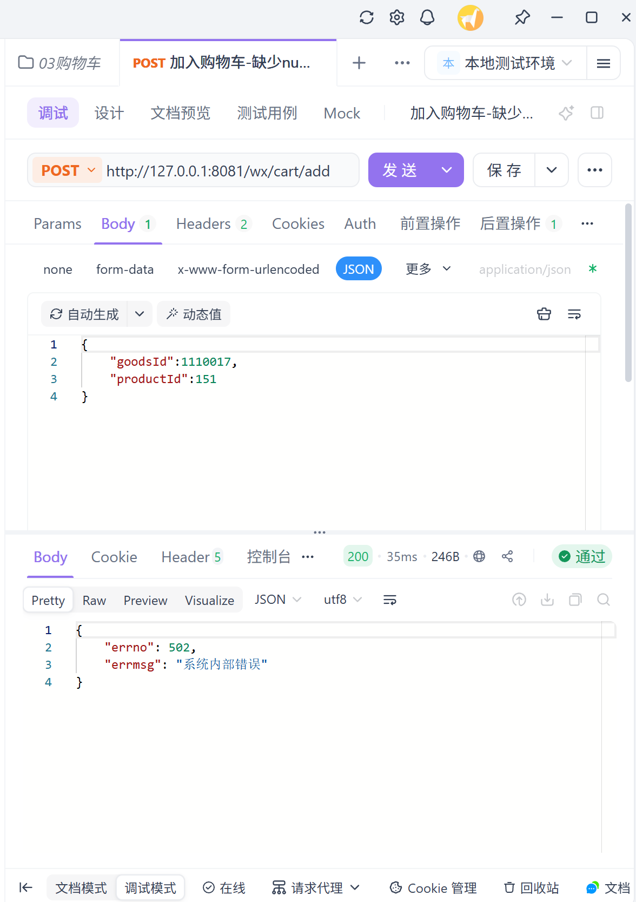

Linux容器日志关键证据：

```text
java.lang.NullPointerException
at org.linlinjava.litemall.wx.web.WxCartController.add(WxCartController.java:122)
```

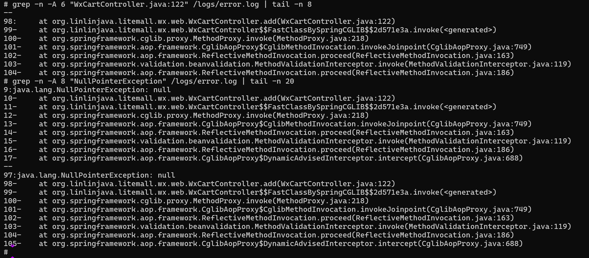

源码在校验`number`是否为空前调用`cart.getNumber().intValue()`，因此发生空指针。

## 6. 缺陷二：同一购物车可以重复提交订单

使用同一`cartId`连续调用两次订单提交接口，两次均返回`errno=0`并生成不同`orderId`。

第一次使用`cartId=89`提交成功并生成`orderId=56`：

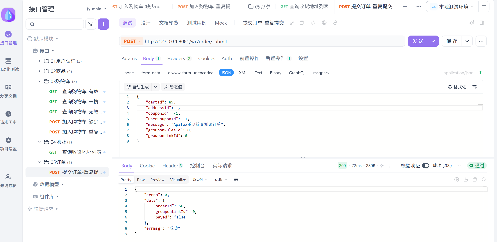

请求内容保持不变再次提交，仍然成功并生成新的`orderId=57`：

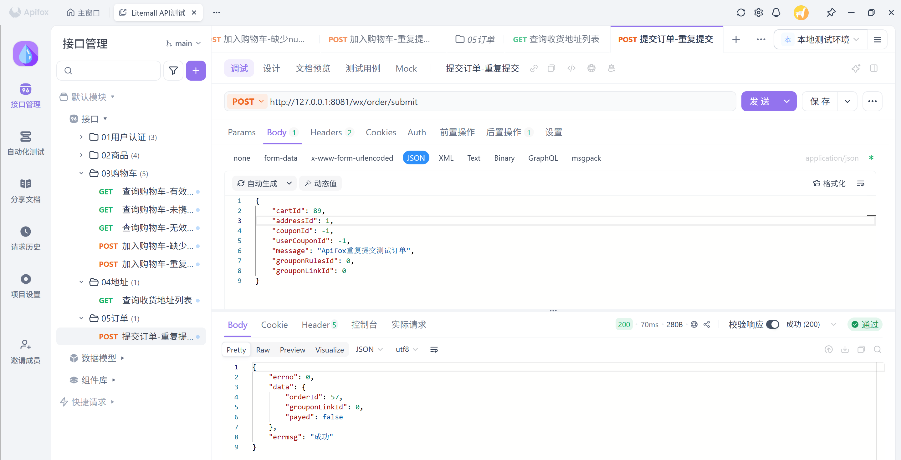

数据库交叉验证显示订单56和57均真实落库，属于同一用户且均未删除；两条订单商品记录的`goods_id=1110017`、`product_id=151`、`number=1`完全相同：

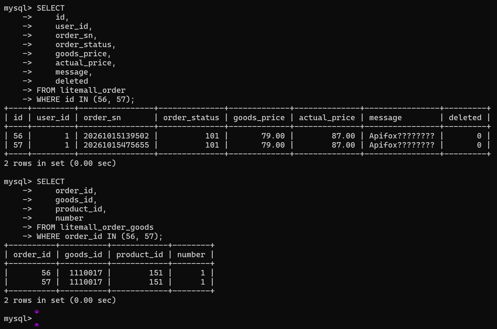

根因定位：第一次提交后，订单服务调用`cartService.deleteById(cartId)`将购物车记录逻辑删除；但再次提交时调用的是`cartService.findById(cartId)`。该查询直接使用`selectByPrimaryKey(id)`，没有同时校验当前用户和`deleted=false`，因此仍能读取已删除的购物车记录，随后再次创建订单、写入订单商品并扣减库存。接口也没有幂等键、一次性提交令牌或业务唯一约束阻止同一业务请求重复执行。

数据库查询进一步确认`cartId=89`在第一次提交后已经是`deleted=1`，证明第二次订单仍然消费了已经逻辑删除的购物车记录：

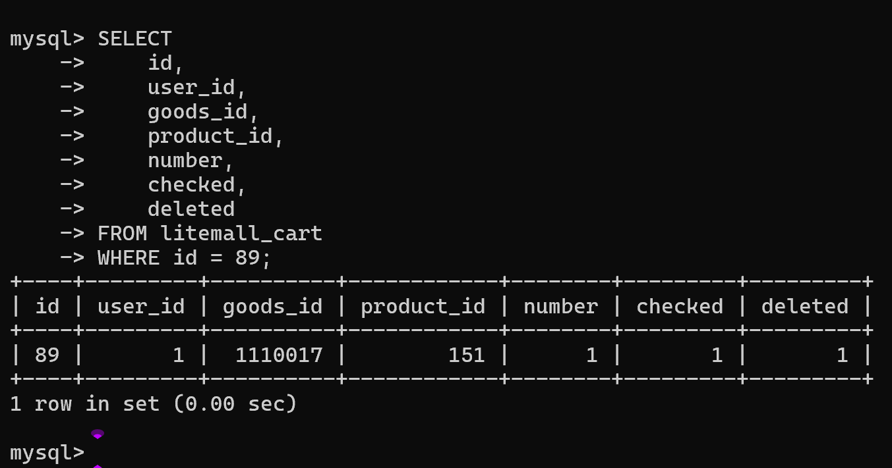

风险包括：

- 用户双击或网络重试产生重复订单；
- 同一购物车数据被重复使用；
- SKU库存被重复扣减；
- 接口缺少幂等控制。

建议在提交订单时重新校验购物车记录有效状态，并引入请求幂等键、一次性提交令牌或业务唯一约束。

## 7. 缺陷三：第二用户可以提交第一用户购物车

用户B携带自己的有效Token和地址，但在请求体中传入用户A的`cartId=90`。按照对象归属校验要求，接口应拒绝该请求，不能生成订单，也不能改变用户A的购物车。

请求使用用户B的`X-Litemall-Token`，接口却返回`errno=0`并生成`orderId=58`，预设的“`errno`不等于0”和“`data.orderId`不存在”两条断言均失败：

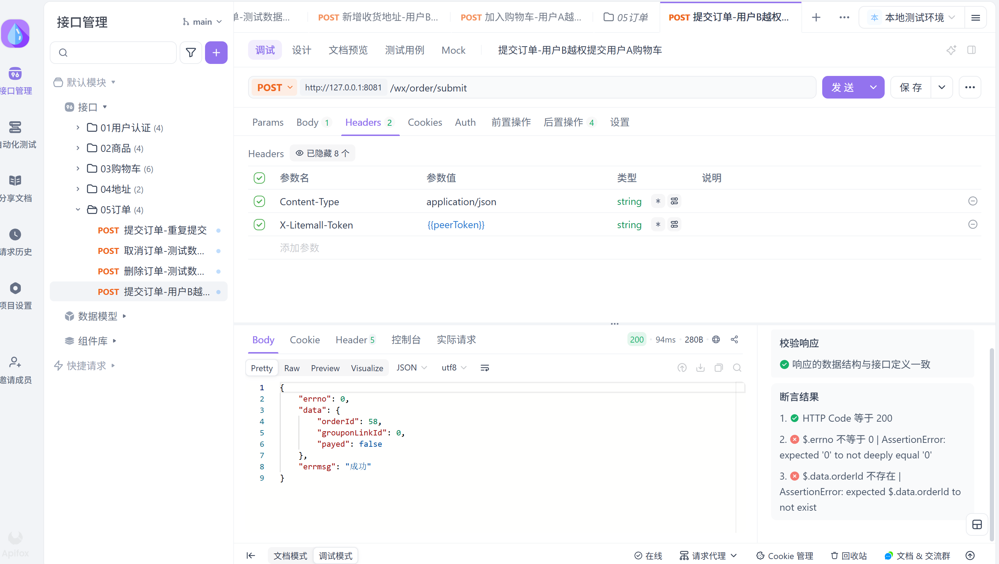

请求体中的`cartId`来自用户A，`addressId`来自用户B，证明测试不是普通的用户B下单：

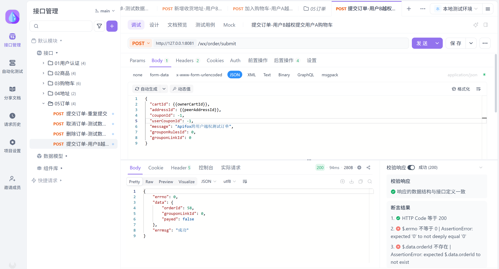

数据库交叉验证结果如下：

- `litemall_order.id=58`的`user_id=2`，说明订单属于用户B；
- `litemall_cart.id=90`的`user_id=1`，说明被消费的购物车属于用户A；
- 订单明细与购物车的`goods_id=1110017`、`product_id=151`、`number=1`完全一致；
- `litemall_cart.id=90`变为`deleted=1`，说明用户A的购物车还被用户B的操作逻辑删除；
- `litemall_address.id=2`的`user_id=2`，说明收货地址确实属于用户B。

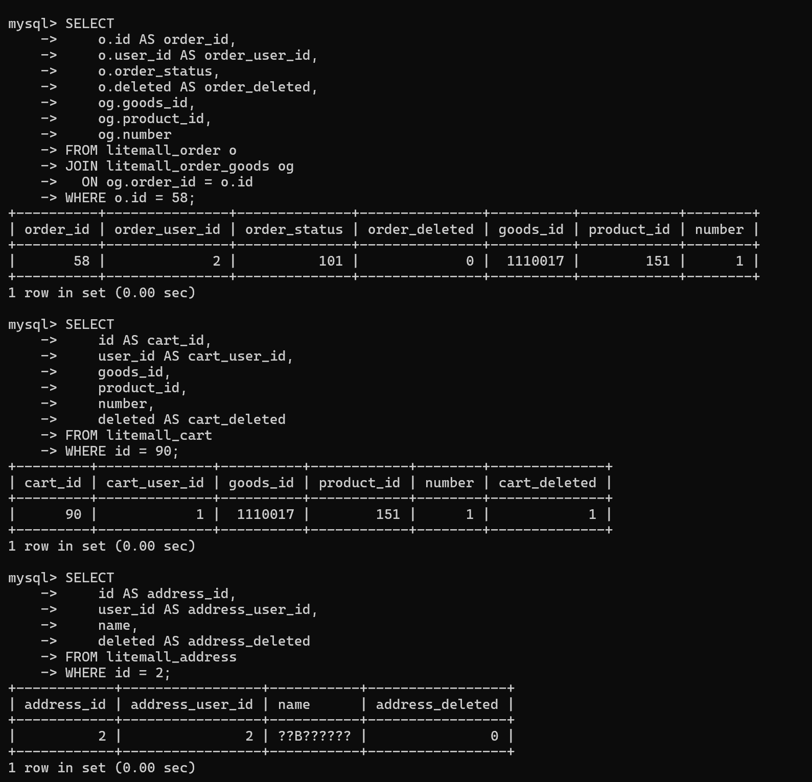

源码中的关键差异：

```text
购物车结算：cartService.findById(userId, cartId)
订单提交：  cartService.findById(cartId)
```

结算接口同时使用`userId`与`cartId`查询，因此能够拒绝跨用户操作；订单提交虽然完成了Token认证，并使用`addressService.query(userId, addressId)`校验了地址归属，但读取购物车时只调用`cartService.findById(cartId)`，没有同时校验购物车归属和`deleted=false`，形成对象级授权缺失。也就是说，系统只确认了“用户B已经登录”，没有确认“用户B是否有权使用购物车90”。

风险包括：

- 已登录用户只要获得或猜中其他用户的购物车ID，就可能使用其中的商品创建订单；
- 被操作用户的购物车会被逻辑删除，影响其正常购物流程；
- 异常订单会真实落库并影响库存；
- 单纯验证Token有效无法发现此类对象归属问题。

建议订单提交改为调用`findById(userId, cartId)`，同时校验`user_id`和`deleted=false`；查询不到时返回统一的业务错误，并确保失败路径不创建订单、不删除购物车、不扣减库存。修复后应保留用户A/用户B双账号回归用例，并继续覆盖已删除购物车和并发提交场景。

该问题已提交为禅道Bug #5，严重程度1、优先级1，当前状态为激活：

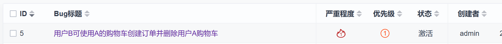

禅道记录包含前置条件、复现步骤、实际结果、期望结果、初步定位、风险说明以及三份原始证据附件：

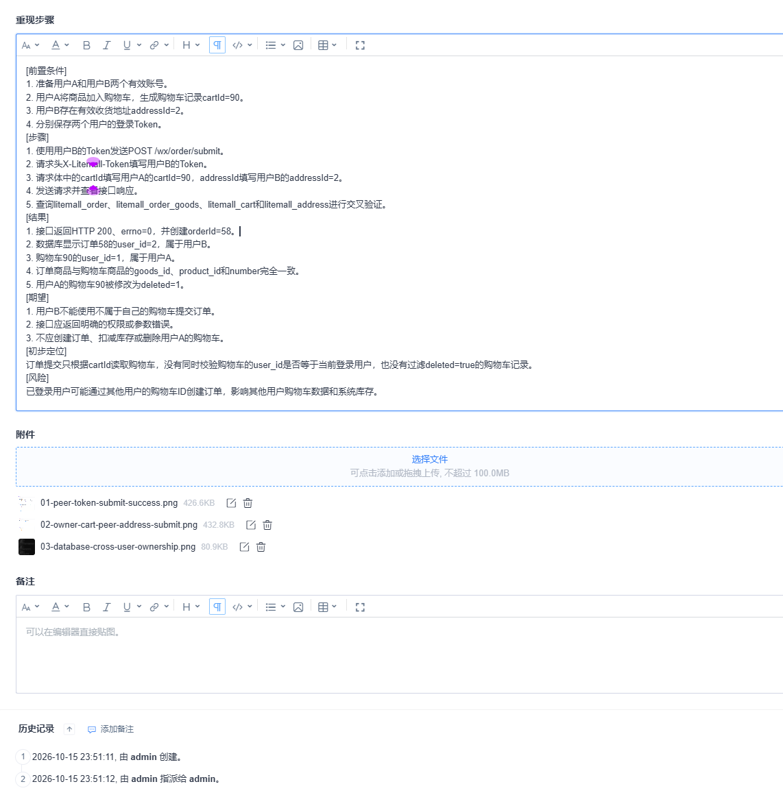

## 8. 测试结论

地址和订单查询接口的用户隔离有效，购物车结算与修改也能阻止跨用户访问；但订单提交存在高风险越权和重复提交问题，购物车参数空值处理存在异常兜底问题。

这组测试说明权限测试不能只验证“有没有Token”，还要验证“当前Token是否有权操作这个具体业务对象”；异常测试也不能只看HTTP 200，而要继续检查`errno`、数据库变化、库存变化和服务端日志。
