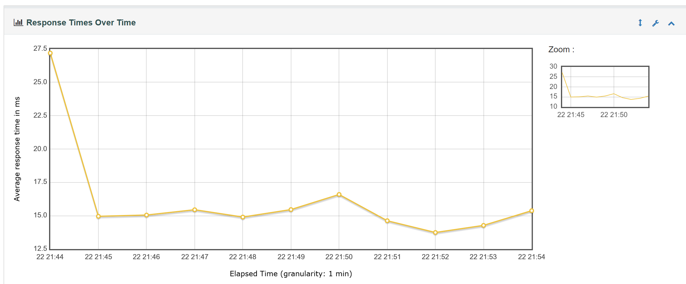
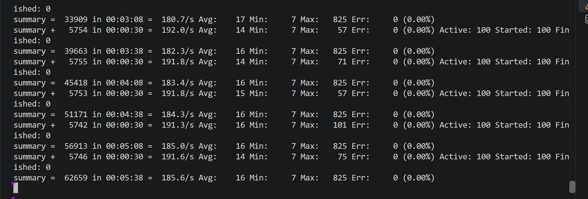

# Litemall 性能测试

## 1. 测试目标

使用 JMeter 对 Litemall 商城首页接口进行基准测试、负载测试、压力测试和稳定性测试，并结合 Docker 资源监控分析应用服务与 MySQL 数据库在不同负载下的性能变化。

被测接口：

```text
GET http://127.0.0.1:8081/wx/home/index
```

主要观察指标：

- 请求成功率和错误率
- 平均响应时间
- P90、P95、P99响应时间
- 吞吐量
- Litemall容器CPU和内存
- MySQL容器CPU和内存
- 容器PIDs数量

## 2. 项目结构

```text
test-performance
├─ jmeter
│  ├─ litemall_home.jmx
│  ├─ litemall_home_load.jmx
│  ├─ litemall_home_stress.jmx
│  └─ litemall_home_sustained.jmx
├─ scripts
│  ├─ run_jmeter.ps1
│  ├─ monitor_docker.ps1
│  ├─ analyze_docker_stats.ps1
│  └─ run_performance_test.ps1
├─ docs
│  └─ screenshots
└─ results
```

目录说明：

- `jmeter`：JMeter测试计划
- `scripts`：测试执行、Docker监控和结果分析脚本
- `docs/screenshots`：用于GitHub展示和项目说明的关键截图
- `results`：JTL、日志、HTML报告和监控原始数据，本地保存但不提交Git

## 3. 环境要求

- Litemall后端服务正常运行
- MySQL服务正常运行
- Docker Desktop正常运行
- Java 21
- Apache JMeter 5.6.3
- Windows PowerShell

运行测试前访问：

```text
http://127.0.0.1:8081/wx/home/index
```

接口应返回 HTTP 200，并且业务响应中的 `errno` 为 `0`。

## 4. 一键执行

在项目根目录运行：

```text
D:\study\softtest\Litemall\litemall
```

执行命令：

```powershell
powershell.exe -ExecutionPolicy Bypass `
    -File ".\test-performance\scripts\run_performance_test.ps1" `
    -Users 100 `
    -RampUp 20 `
    -Duration 120 `
    -Delay 500 `
    -RunName "home-stress-100u" `
    -JMeterHome "D:\study\softtest\tool\Jmeter\apache-jmeter-5.6.3"
```

总控脚本执行流程：

```text
接收测试参数
→ 检查脚本和历史结果
→ 启动Docker资源监控
→ 执行JMeter测试
→ 停止Docker资源监控
→ 根据JMeter时间窗口过滤监控数据
→ 生成资源汇总结果
```

## 5. 参数说明

| 参数 | 含义 | 示例 |
|---|---|---:|
| `Users` | 并发虚拟用户数 | 100 |
| `RampUp` | 启动全部用户所需时间，单位为秒 | 20 |
| `Duration` | 测试持续时间，单位为秒 | 120 |
| `Delay` | 每次请求后的等待时间，单位为毫秒 | 500 |
| `RunName` | 本次测试的唯一名称 | home-stress-100u |
| `MonitorInterval` | Docker资源采样间隔，单位为秒 | 2 |
| `JMeterHome` | JMeter安装目录 | apache-jmeter-5.6.3 |

每次测试必须使用新的 `RunName`，避免覆盖历史测试证据。

## 6. 输出文件

假设：

```text
RunName = home-stress-100u
```

测试会生成：

```text
home-stress-100u.jtl
home-stress-100u.log
home-stress-100u-report
home-stress-100u-docker-stats.txt
home-stress-100u-docker-summary.csv
```

文件作用：

- `.jtl`：每个请求的原始结果
- `.log`：JMeter运行日志
- `-report`：JMeter HTML可视化报告
- `-docker-stats.txt`：Docker资源原始采样
- `-docker-summary.csv`：CPU、内存和PIDs汇总结果

## 7. 设计说明

JMeter测试结果用于观察用户侧的响应时间、吞吐量和错误率。

Docker监控用于观察Litemall应用与MySQL数据库在压力下的CPU、内存和进程变化。

分析脚本从JMeter日志中读取实际测试开始和结束时间，只统计同一时间窗口内的Docker监控数据，避免压测前后空闲数据影响平均值。

总控脚本使用 `try/finally` 管理监控进程，保证JMeter成功或失败后都能停止Docker资源监控。v

## 8. 性能测试结果

### 8.1 测试计划演进

| 阶段 | 用户数 | 请求数 | 平均响应时间(ms) | P95(ms) | P99(ms) | 吞吐量(次/秒) | 错误率 |
|---|---:|---:|---:|---:|---:|---:|---:|
| 基准测试 | 1 | 20 | 38.85 | 106.60 | 107.00 | 1.91 | 0.00% |
| 固定循环负载测试 | 10 | 100 | 29.01 | 45.90 | 191.61 | 7.28 | 0.00% |
| 3分钟持续测试 | 10 | 3375 | 12.17 | 16.00 | 21.00 | 18.82 | 0.00% |

以上三组数据用于验证测试计划从固定循环逐步演进为按时间持续执行。由于循环方式和运行时间不同，不能仅根据吞吐量直接判断三组测试之间的性能优劣。

### 8.2 压力测试对比

压力测试保持接口、持续时间和请求间隔基本一致，只调整并发用户数，用于观察负载增加后的性能变化。

| 并发用户数 | 请求数 | 平均响应时间(ms) | P90(ms) | P95(ms) | P99(ms) | 吞吐量(次/秒) | 错误率 |
|---:|---:|---:|---:|---:|---:|---:|---:|
| 20 | 4263 | 11.18 | 14.00 | 16.00 | 19.00 | 35.70 | 0.00% |
| 50 | 10579 | 11.99 | 16.00 | 18.00 | 23.00 | 88.60 | 0.00% |
| 100 | 21072 | 14.59 | 21.00 | 27.00 | 50.00 | 176.40 | 0.00% |
| 200 | 41459 | 23.17 | 34.00 | 46.00 | 109.00 | 347.00 | 0.00% |
| 300 | 46424 | 202.95 | 313.00 | 355.00 | 419.00 | 388.26 | 0.00% |

## 9. 性能拐点分析

从20用户增加到200用户时，吞吐量由每秒35.70次提升至347.00次，整体接近随并发用户数同步增长；平均响应时间由11.18ms增加至23.17ms，增长相对平缓。

从200用户增加到300用户时：

- 并发用户数增加50%
- 吞吐量由347.00次/秒增加至388.26次/秒，仅增加约11.9%
- 平均响应时间由23.17ms增加至202.95ms，约为原来的8.8倍
- P95由46ms增加至355ms
- P99由109ms增加至419ms
- 错误率仍为0.00%

这表明在当前本地环境和测试模型下，系统在200至300并发用户之间出现明显性能拐点。继续增加并发时，吞吐量增长幅度已经明显下降，而响应时间快速上升。

错误率为0只能说明请求仍然成功，不能说明系统在300并发下仍具有良好的性能。响应时间和长尾延迟已经明显恶化。

由于本项目没有给定正式性能SLA，因此这里使用不同负载下的相对变化识别性能拐点，不直接将某个并发数定义为系统的绝对最大容量。

## 10. 服务端参数A/B测试

### 10.1 测试目的

300并发用户时，系统出现响应时间显著上升、吞吐量增幅下降的现象。为判断数据库连接池和Web服务器线程数是否为主要限制因素，在保持300用户、120秒持续时间和500ms请求间隔基本一致的条件下，分别修改Druid连接池和Tomcat线程数进行A/B测试。

A/B测试遵循以下原则：

- 每次只修改一个主要配置
- 使用相同接口和负载参数
- 对比响应时间、吞吐量、错误率和服务端资源
- 无效或负向优化必须恢复
- 不根据单一指标直接判断优化是否有效

A/B测试的分析过程是：

```text
发现性能问题
→ 提出可以验证的假设
→ 一次只修改一个主要变量
→ 保持测试负载一致
→ 比较修改前后的数据
→ 根据证据接受或否定假设
→ 恢复无效配置
```

### 10.2 Druid连接池A/B测试

Druid是应用使用的数据库连接池。`max-active` 控制连接池中允许同时存在的最大活跃数据库连接数。

数据库连接池的基本调用过程是：

```text
请求需要查询数据库
→ 应用向Druid申请数据库连接
→ 获得连接后访问MySQL
→ SQL执行结束后归还连接
```

基线配置：

```yaml
max-active: 50
```

实验配置：

```yaml
max-active: 100
```

测试结果：

| 方案 | Druid最大活跃连接数 | 请求数 | 平均响应时间(ms) | P95(ms) | P99(ms) | 吞吐量(次/秒) | 错误率 |
|---|---:|---:|---:|---:|---:|---:|---:|
| 基线配置 | 50 | 46424 | 202.95 | 355 | 419 | 388.26 | 0.00% |
| Druid实验配置 | 100 | 36203 | 406.14 | 661 | 728 | 302.77 | 0.00% |

服务端资源对比：

| 方案 | Litemall平均CPU | Litemall最高CPU | MySQL平均CPU | MySQL最高CPU | MySQL最大PIDs |
|---|---:|---:|---:|---:|---:|
| 基线配置 | 578.69% | 702.78% | 306.41% | 396.84% | 77 |
| Druid连接数100 | 573.66% | 796.07% | 291.66% | 370.85% | 127 |

将Druid最大活跃连接数由50提高到100后：

- 平均响应时间由202.95ms增加至406.14ms
- P95由355ms增加至661ms
- 吞吐量由388.26次/秒下降至302.77次/秒
- MySQL最大PIDs由77增加至127
- 错误率仍为0.00%

结果表明，增加数据库连接数没有改善本次测试性能，反而使响应时间升高、吞吐量下降。更多数据库连接不代表更高性能，过多并发连接可能增加数据库竞争、调度和等待成本。

因此，本次实验否定了“将Druid最大活跃连接数从50增加到100可以改善300并发性能”的假设，并将配置恢复为：

```yaml
max-active: 50
```

### 10.3 Tomcat线程数A/B测试

Tomcat工作线程用于接收和处理HTTP请求。项目使用的Spring Boot版本默认最大工作线程数为200。

Tomcat线程处理请求的基本过程是：

```text
HTTP请求到达
→ Tomcat分配工作线程
→ 工作线程执行业务代码
→ 业务代码可能继续申请Druid数据库连接
→ 执行完成后返回HTTP响应
```

实验中保持Druid最大活跃连接数为50，只将Tomcat最大线程数设置为：

```yaml
server:
  tomcat:
    max-threads: 400
```

测试结果：

| 方案 | Tomcat最大线程数 | 请求数 | 平均响应时间(ms) | P95(ms) | P99(ms) | 吞吐量(次/秒) | 错误率 |
|---|---:|---:|---:|---:|---:|---:|---:|
| 默认配置 | 200 | 46424 | 202.95 | 355 | 419 | 388.26 | 0.00% |
| Tomcat实验配置 | 400 | 40363 | 312.14 | 531 | 631.99 | 336.87 | 0.00% |

服务端资源对比：

| 方案 | Litemall平均CPU | Litemall最高CPU | Litemall最大PIDs | MySQL平均CPU | MySQL最高CPU |
|---|---:|---:|---:|---:|---:|
| 默认配置 | 578.69% | 702.78% | 251 | 306.41% | 396.84% |
| Tomcat线程数400 | 550.31% | 715.34% | 315 | 268.30% | 319.83% |

将Tomcat最大线程数由默认200提高到400后：

- 平均响应时间由202.95ms增加至312.14ms
- P95由355ms增加至531ms
- 吞吐量由388.26次/秒下降至336.87次/秒
- Litemall最大PIDs由251增加至315
- 错误率仍为0.00%

结果表明，增加Tomcat线程数没有改善本次测试性能。更多线程可能增加线程调度、上下文切换以及等待数据库连接的成本。

因此，本次实验否定了“将Tomcat最大线程数从200增加到400可以改善300并发性能”的假设，并删除实验配置，恢复Spring Boot默认设置。

### 10.4 参数之间的关系

Tomcat线程和Druid数据库连接不是互相独立的。

一个请求的简化执行过程是：

```text
JMeter发送HTTP请求
→ Tomcat使用工作线程处理请求
→ 业务代码向Druid申请连接
→ Druid将数据库连接交给业务代码
→ 业务代码访问MySQL
→ MySQL返回查询结果
→ 应用向JMeter返回HTTP响应
```

如果Tomcat线程很多，但Druid连接有限，可能出现：

```text
大量Tomcat线程进入业务代码
→ 线程等待数据库连接
→ 等待线程和调度成本增加
→ 响应时间可能上升
```

如果Druid连接很多，但MySQL和CPU资源有限，可能出现：

```text
更多SQL同时进入MySQL
→ 数据库内部竞争加剧
→ CPU调度和连接管理成本增加
→ 吞吐量不一定提高
```

因此，线程数和连接数不是越大越好，而是要与CPU、内存、数据库处理能力和实际业务负载相匹配。

### 10.5 A/B测试结论

两次实验均未改善300并发下的性能：

- 增加Druid连接数后，响应时间进一步上升、吞吐量下降
- 增加Tomcat线程数后，响应时间同样上升、吞吐量下降
- 错误率始终为0，但延迟指标明显恶化
- 单纯增加连接数或线程数不能解决当前性能拐点

测试结果说明，连接池和线程池同时具有流量控制作用。盲目放大并发处理能力，可能将更多请求同时推向有限的CPU和数据库资源，导致竞争加剧。

当前证据能够证明：

- Druid最大活跃连接数由50增加到100没有改善本次测试性能
- Tomcat最大线程数由默认200增加到400没有改善本次测试性能
- 两项实验配置均应恢复

当前证据不能直接证明：

- Druid是唯一性能瓶颈
- Tomcat是唯一性能瓶颈
- MySQL是唯一性能瓶颈
- CPU竞争是唯一根因

进一步定位还需要结合以下数据：

- JVM堆内存和垃圾回收
- Java线程状态和线程栈
- 慢SQL
- 数据库锁等待
- 数据库查询执行计划
- 操作系统CPU调度
- 磁盘I/O和网络I/O

因此，本次A/B测试的严谨结论是：

> 在当前本地环境、测试接口和300并发负载下，单独提高Druid最大活跃连接数或Tomcat最大线程数均未改善性能，反而导致响应时间上升、吞吐量下降。当前数据说明存在资源竞争或排队现象，但不足以确定唯一根因。

## 11. 稳定性测试

### 11.1 测试目的

压力测试用于观察系统在不同并发用户数下的性能变化，而稳定性测试用于观察系统在固定负载下持续运行时，性能和资源是否逐渐恶化。

本次稳定性测试重点检查：

- 请求是否持续成功
- 响应时间是否持续上升
- 长尾响应时间是否明显恶化
- 吞吐量是否出现持续下降
- 应用内存是否持续单向增长
- MySQL内存是否持续单向增长
- CPU和PIDs是否出现异常变化

### 11.2 测试配置

| 配置项 | 设置值 |
|---|---:|
| 并发用户数 | 100 |
| Ramp-up | 20秒 |
| 持续时间 | 600秒 |
| 请求间隔 | 500ms |
| 被测接口 | `/wx/home/index` |
| Docker监控对象 | `litemall`、`mysql` |

参数关系如下：

```text
100个虚拟用户
→ 在20秒内逐步启动
→ 启动后持续循环请求首页接口
→ 每次请求结束后等待500ms
→ 整个测试持续600秒
```

`Ramp-up=20` 表示100个用户在20秒内逐步启动，不是每个用户只运行20秒。

`Duration=600` 表示整个线程组持续运行600秒，即10分钟。

`Delay=500` 表示同一个虚拟用户完成一次请求后，等待500毫秒再发出下一次请求。

### 11.3 JMeter测试结果

| 指标 | 测试结果 |
|---|---:|
| 请求总数 | 113015 |
| 失败请求数 | 0 |
| 错误率 | 0.00% |
| 平均响应时间 | 15.57ms |
| 中位数 | 13.00ms |
| P90 | 20.00ms |
| P95 | 23.00ms |
| P99 | 32.00ms |
| 最大响应时间 | 825ms |
| 吞吐量 | 188.54次/秒 |

测试期间共完成113015次请求，没有出现请求失败。

平均响应时间为15.57ms，P95为23ms，P99为32ms，说明绝大多数请求保持在较低响应时间范围内。

最大响应时间达到825ms，说明测试期间存在少量瞬时慢请求。但最大值只代表最慢的一次请求，不能单独代表整体性能，需要结合P95、P99和响应时间趋势共同判断。

判断逻辑是：

```text
最大值较高
但P95和P99较低
并且错误率为0
响应时间没有持续上升
→ 更可能是少量瞬时波动
→ 暂不能判断为整体性能恶化
```

### 11.4 Docker资源结果

Docker原始监控文件曾包含压测结束后的空闲数据。分析脚本根据JMeter日志识别实际测试时间：

```text
测试开始：2026-09-22 21:44:22
测试结束：2026-09-22 21:54:22
```

只保留该10分钟窗口内的资源数据，最终每个容器获得165次有效采样。

资源汇总如下：

| 指标 | Litemall | MySQL |
|---|---:|---:|
| 有效采样数 | 165 | 165 |
| 平均CPU | 212.90% | 118.84% |
| 最高CPU | 314.31% | 171.30% |
| 开始内存 | 866.3MiB | 260.3MiB |
| 结束内存 | 849.7MiB | 261.4MiB |
| 最低内存 | 742.7MiB | 259.4MiB |
| 最高内存 | 918.2MiB | 262.1MiB |
| 平均内存 | 837.74MiB | 261.39MiB |
| 最大PIDs | 146 | 59 |

Docker中的CPU使用率以一个逻辑CPU核心约等于100%计算：

- Litemall平均CPU为212.90%，约相当于持续使用2.13个逻辑CPU核心
- MySQL平均CPU为118.84%，约相当于持续使用1.19个逻辑CPU核心
- CPU超过100%表示容器使用了多个逻辑CPU核心，不代表数据错误

### 11.5 内存趋势分析

Litemall内存变化：

```text
开始：866.3MiB
结束：849.7MiB
最低：742.7MiB
最高：918.2MiB
```

MySQL内存变化：

```text
开始：260.3MiB
结束：261.4MiB
最低：259.4MiB
最高：262.1MiB
```

Litemall结束内存低于开始内存，MySQL内存只发生小幅波动。两个容器均未出现测试时间内持续单向增长的现象。

因此，本次测试可以得出的结论是：

> 在本次100并发、10分钟运行条件下，没有观察到明显的持续内存增长现象。

但不能直接得出：

> 系统一定不存在内存泄漏。

原因是10分钟测试时间仍然较短。部分内存泄漏只有在数小时或数天的运行、特定业务操作反复执行或多次垃圾回收后才会明显出现。

更严谨的表达是：

> 本次10分钟稳定性测试未发现明显内存泄漏迹象，但若要进一步确认，需要延长测试时间并结合JVM堆内存、垃圾回收和对象数量进行分析。

### 11.6 稳定性测试截图

JMeter统计结果：


响应时间趋势：



Docker资源监控：



### 11.7 稳定性测试结论

在当前本地环境、商城首页接口、100并发用户和10分钟持续运行条件下：

- 113015次请求全部成功
- 错误率为0.00%
- 平均响应时间为15.57ms
- P95为23ms，P99为32ms
- 吞吐量为188.54次/秒
- 响应时间未出现持续恶化
- Litemall和MySQL内存未出现持续单向增长
- 未观察到明显的服务异常或资源失控

因此，本次10分钟稳定性测试结果正常。

该结论只适用于本次测试环境、接口、数据量和负载模型，不能直接代表生产环境，也不能代替更长时间、更完整业务链路的稳定性测试。

## 12. 测试限制与改进方向

### 12.1 当前测试范围

本次性能测试主要覆盖：

- 商城首页接口 `/wx/home/index`
- 1至300并发用户
- 基准测试、负载测试、压力测试和稳定性测试
- JMeter响应时间、吞吐量和错误率
- Litemall与MySQL容器的CPU、内存和PIDs
- Druid连接池和Tomcat线程数A/B测试

本次结果能够反映当前本地环境下，商城首页接口面对不同并发负载时的性能变化，但不能代表整个Litemall系统的完整性能。

### 12.2 单接口测试限制

本次主要测试的是商城首页查询接口：

```text
GET /wx/home/index
```

该接口属于未登录即可访问的读请求，没有覆盖完整业务链路，例如：

```text
用户登录
→ 搜索商品
→ 查看商品详情
→ 加入购物车
→ 选择地址
→ 提交订单
→ 查询订单
→ 取消订单
```

真实用户不会只反复访问首页。因此，当前结果更接近“首页接口专项性能测试”，不是完整电商业务场景的容量结果。

后续可以设计混合业务场景，让不同虚拟用户按照一定比例执行不同操作，例如：

| 业务场景 | 建议比例 |
|---|---:|
| 浏览首页 | 30% |
| 搜索商品 | 25% |
| 查看商品详情 | 20% |
| 查询购物车 | 10% |
| 加入购物车 | 8% |
| 提交订单 | 5% |
| 查询订单 | 2% |

该比例只是示例，正式项目应根据生产流量或业务预期确定。

### 12.3 测试环境限制

JMeter、Docker Desktop、Litemall和MySQL运行在同一台Windows电脑上。

因此它们会共同竞争本机资源：

```text
JMeter消耗CPU和内存
+
Litemall容器消耗CPU和内存
+
MySQL容器消耗CPU和内存
+
Windows和Docker Desktop自身消耗资源
```

在高并发下，JMeter负载机自身也可能影响测试结果。

更规范的测试环境应当：

```text
压力发生机与被测服务器分离
```

例如：

```text
机器A：运行JMeter并产生压力
机器B：运行Litemall应用
机器C：运行MySQL数据库
机器D：运行监控系统
```

这样可以减少负载发生器与被测服务之间的资源竞争。

### 12.4 测试数据和网络限制

当前使用的是本地测试数据和本地网络：

```text
JMeter → 127.0.0.1 → Docker Desktop → Litemall
```

这与生产环境存在差异：

- 本地网络延迟很低
- 数据库数据量较小
- 没有真实公网波动
- 没有负载均衡和多应用实例
- 没有生产环境复杂依赖
- 没有真实用户地域差异
- 没有生产规模的数据增长

因此，本地测试结果不能直接换算为生产环境容量。

### 12.5 监控指标限制

当前服务端监控主要来自：

```text
docker stats
```

已采集：

- CPU
- 内存
- 网络I/O
- 磁盘I/O
- PIDs

但还没有完整采集：

- JVM堆内存
- JVM非堆内存
- 垃圾回收次数和耗时
- Java线程状态
- Tomcat活动线程和请求队列
- Druid连接池等待数量和等待时间
- MySQL慢SQL
- MySQL锁等待
- SQL执行计划
- 主机整体CPU负载
- 磁盘响应时间
- 网络延迟

因此，当前监控能够帮助识别资源变化和性能拐点，但不足以单独确定唯一根因。

后续可以接入：

- JConsole或VisualVM
- Spring Boot Actuator
- Prometheus
- Grafana
- MySQL慢查询日志
- Linux `pidstat`、`vmstat`、`iostat`
- APM系统

### 12.6 测试时间限制

本次稳定性测试持续10分钟。

10分钟可以发现：

- 接口是否持续报错
- 响应时间是否快速恶化
- CPU和内存是否明显失控
- 短时间内是否存在资源持续增长

但不能充分发现：

- 缓慢内存泄漏
- 长时间连接泄漏
- 数小时后才触发的垃圾回收问题
- 日志文件持续增长导致的磁盘问题
- 定时任务与业务请求产生的长期冲突

后续可以将稳定性测试扩展到1小时、4小时或更长时间，并定期记录JVM和数据库指标。

### 12.7 重复测试限制

当前每个主要配置主要执行了一次正式测试。

单次测试可能受到以下因素影响：

- JVM预热状态
- 操作系统后台任务
- Docker Desktop状态
- 数据库缓存状态
- 瞬时CPU调度
- 其他本机程序占用资源

更严谨的做法是：

```text
同一配置重复执行至少3次
→ 去除明显异常结果
→ 比较平均值或中位数
→ 再判断配置变化是否有效
```

因此，本次A/B测试能够说明实验配置没有表现出改善，但如果用于正式生产调优，还应进行多轮重复验证。

### 12.8 性能SLA限制

本项目没有给定正式性能SLA，例如：

```text
错误率必须低于0.1%
P95必须低于200ms
吞吐量必须达到500次/秒
```

因此，本次测试主要通过不同并发等级之间的相对变化识别性能拐点，不能直接声明某个并发等级“符合生产要求”。

正式项目应在测试前由产品、开发、架构和运维共同确定性能目标，再根据SLA判断测试通过或失败。

### 12.9 源码层面的后续分析方向

商城首页请求由 `WxHomeController.index()` 处理。

一个首页请求会创建广告、分类、优惠券、新品、热门商品、品牌、专题、团购和楼层商品等多个查询任务，并提交到应用内部的固定线程池。

简化调用过程如下：

```text
Tomcat工作线程
→ WxHomeController
→ 首页内部固定线程池
→ 多个Service查询
→ Mapper和MyBatis
→ Druid连接池
→ MySQL
```

当前代码中的首页缓存开关为关闭状态：

```java
public static final boolean ENABLE = false;
```

因此，每次首页请求都会执行相关查询，而不是直接从缓存返回。

在300并发下出现性能拐点，可能与以下因素有关：

- 首页内部固定线程池容量
- 任务队列等待
- `CallerRunsPolicy`使Tomcat线程参与执行任务
- 一个首页请求触发多个数据库查询
- Druid连接等待
- MySQL并发查询竞争
- CPU调度和线程上下文切换

这些属于根据源码和监控数据提出的待验证假设，不能直接写成已经确定的根因。

后续可继续进行：

- 首页内部线程池参数A/B测试
- 首页缓存开启与关闭A/B测试
- 单独统计每类首页查询耗时
- Druid等待线程和获取连接耗时监控
- MySQL慢SQL和执行计划分析
- JVM线程栈分析

### 12.10 后续改进计划

建议按照以下优先级继续完善：

1. 在200至300用户之间增加220、240、260、280用户测试，缩小性能拐点范围。
2. 同一负载至少重复执行3次，降低单次结果波动影响。
3. 将JMeter与被测服务部署到不同机器。
4. 增加登录、搜索、购物车和订单混合业务场景。
5. 增加JVM、Tomcat、Druid和MySQL内部指标。
6. 延长稳定性测试时间。
7. 根据业务要求建立明确的性能SLA。
8. 对首页内部线程池、缓存和SQL进行进一步验证。

## 13. 最终结论

### 13.1 已完成内容

本次Litemall性能测试完成了：

- JMeter测试环境搭建
- 商城首页接口基准测试
- 固定循环负载测试
- 按时间持续负载测试
- 20、50、100、200、300用户逐级压力测试
- 100用户10分钟稳定性测试
- Docker应用和MySQL资源监控
- JMeter与Docker数据时间窗口对齐
- Druid连接池A/B测试
- Tomcat线程数A/B测试
- JMeter非GUI执行
- HTML性能报告生成
- PowerShell参数化执行脚本
- Docker监控脚本
- 资源数据自动分析脚本
- 一键性能测试总控脚本

### 13.2 主要测试发现

在当前本地测试环境和商城首页接口场景下：

1. 20至200并发用户范围内，吞吐量随并发增加而明显提升，平均响应时间增长相对平缓。
2. 从200增加到300并发用户时，吞吐量仅增加约11.9%，平均响应时间约增加到原来的8.8倍。
3. 系统在200至300并发用户之间出现明显性能拐点。
4. 300并发下错误率仍为0.00%，但平均响应时间、P95和P99明显恶化。
5. 将Druid最大活跃连接数从50增加到100没有改善性能，反而使响应时间升高、吞吐量下降。
6. 将Tomcat最大线程数从默认200增加到400同样没有改善性能。
7. 100用户运行10分钟期间，113015次请求全部成功，错误率为0.00%。
8. 10分钟稳定性测试期间，响应时间没有持续恶化，Litemall和MySQL内存没有持续单向增长。
9. 当前数据表明高并发下存在资源竞争或排队现象，但不足以确定唯一根因。

### 13.3 性能测试结论

本次测试证明了以下工程实践：

```text
性能测试不是只观察接口能否返回成功
而是同时分析：
响应时间
+ 长尾延迟
+ 吞吐量
+ 错误率
+ 服务端资源
+ 配置变化前后结果
```

错误率为0不代表性能一定良好。系统虽然可以处理300并发下的请求，但响应时间已明显恶化，不能仅根据“没有失败”判断系统性能正常。

参数调优也不是简单地将数值增大。连接池和线程池同时具有资源控制和流量调节作用，参数过大可能增加竞争、排队和上下文切换成本。

本次测试较严谨的最终结论是：

> 在当前本地环境、测试数据和商城首页接口负载模型下，Litemall在200至300并发用户之间出现明显性能拐点。单独提高Druid连接池容量或Tomcat最大线程数均未改善300并发性能。100并发、10分钟稳定性测试未发现请求错误、持续响应恶化或明显内存泄漏迹象。由于测试环境、接口范围、运行时间和监控深度有限，该结果不能直接代表生产环境容量，也不能用于确定唯一性能瓶颈。